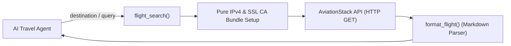

# Flight Tool - Architecture & Implementation Guide

`flight_tool.py` is the execution tool responsible for retrieving live flight schedules and flight status information from the **AviationStack API**, optimized specifically for AI Agent interactions.

---

## Architecture & Network Optimizations



### 1. Windows IPv6 Latency Fix
```python
urllib_connection.HAS_IPV6 = False
```
* **Problem:** On Windows operating systems, dual-stack IPv6/IPv4 DNS queries can cause 10–20 second TCP timeout stalls when connecting to certain external REST APIs.
* **Solution:** Disabling IPv6 forces requests to use pure IPv4, eliminating connection lag.

### 2. SSL CA Bundle Certification
```python
os.environ["SSL_CERT_FILE"] = certifi.where()
os.environ["REQUESTS_CA_BUNDLE"] = certifi.where()
```
* Ensures reliable SSL/TLS certificate verification across diverse local Python environments.

---

## Core Functions

### 1. `format_flight(flight: Dict[str, Any]) -> str`
* Extracts and standardizes airline names, flight numbers, departure/arrival airports, terminals, gates, scheduled timestamps, and delay minutes.
* Implements **Null-Safety** using fallback defaults (`"Unknown airline"`, `"N/A"`) so missing JSON keys do not cause runtime errors.

### 2. `flight_search(destination, origin, date, query, limit) -> str`
* Supports dual modes:
  * **Structured Mode:** Accepts `destination`, `origin`, and `date`.
  * **Natural Language Mode:** Accepts a `query` string (e.g., `"Flights from Sri Lanka to Japan"`), automatically resolving IATA codes via `flight_utils.parse_route()`.
* Multi-tier exception handling for timeouts, network drops, and JSON parsing errors.
