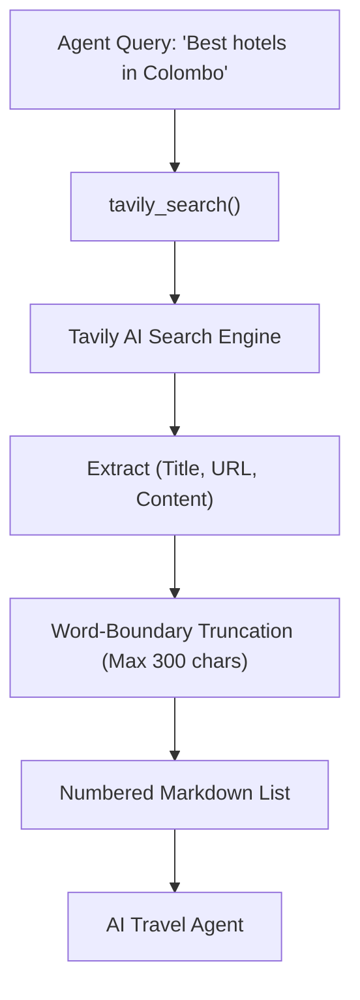

# Tavily Search Tool - Architecture & Implementation Guide

`tavily_tool.py` is the execution tool designed to search the live web for hotel accommodations, sightseeing attractions, and destination recommendations using the **Tavily AI Search SDK**.

---

## Architecture & Data Flow



---

## Key Features & Optimizations

### 1. LLM Context Window Optimization
```python
if len(snippet) > 300:
    snippet = snippet[:300].rsplit(" ", 1)[0] + "..."
```
* **Why:** Raw web search pages often return massive paragraphs that overwhelm the LLM's context window and increase token cost.
* **Word-Boundary Clipping:** `rsplit(" ", 1)[0]` ensures text is cut off cleanly at the last full word rather than splitting words in half.

### 2. Graceful Degradation
* If `TAVILY_API_KEY` is missing from the environment, the tool does not crash or throw exceptions. Instead, it returns a polite informative guide for the user to configure `.env`.
