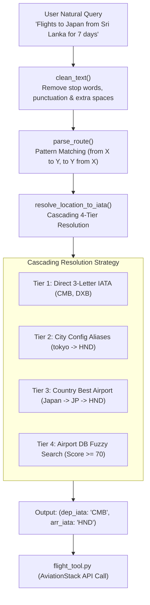

# Flight Utils - Architecture & Technical Guide

`flight_utils.py` serves as the **Data Preprocessing and Natural Language Processing (NLP)** layer of the Multi-Agent TourAI project. Its core responsibility is to extract and resolve 3-letter IATA airport codes (e.g., `CMB`, `DXB`, `HND`) from free-form user queries.

---

## Architecture & Data Flow

---

## Key Benefits & Advantages

### 1. High Performance & Low Latency
* **Fast In-Memory Lookups:** Leverages an offline airport database (`airportsdata`) and country lookup library (`pycountry`), avoiding external network calls during location resolution.
* **LRU Caching:** Frequently searched locations (e.g., `Sri Lanka`, `Japan`, `Dubai`) are stored in memory via `@lru_cache`, returning results in constant $O(1)$ time.

### 2. LLM Token & Context Window Optimization
* **Stop Words Stripping:** Automatically removes noise words (`flight`, `tickets`, `trip`, `hotel`, `budget`) from queries before processing.
* **Clean Structured Output:** Passes only compact, verified 3-letter IATA codes (`CMB`, `HND`) to AI Agents, minimizing prompt token consumption and reducing LLM API costs.

### 3. Zero-Crash Resilience & Fault Tolerance
* **Graceful Degradation:** If an input is incomplete or ambiguous, it safely falls back to sensible defaults (e.g., `DEFAULT_ORIGIN_IATA = "CMB"`).
* **Safe Configuration Loading:** Missing or corrupted `config.yaml` files are handled safely with an empty fallback dictionary, preventing runtime crashes.

### 4. Separation of Concerns & Clean Architecture
* **Modular Decoupling:** Isolates string preprocessing and NLP routing inside `utils/`, leaving `tools/flight_tool.py` focused purely on API communication.
* **Testability:** Every utility function can be unit tested independently without needing live internet connections or paid API credentials.

### 5. Lightweight Rule-Based NLP
* **No Heavy Model Dependencies:** Extracts routes accurately using regex patterns and word boundaries (`\b`) without the overhead of heavy transformer models (e.g., spaCy, BERT).

---

## Core Concepts & Design Principles

### 1. Memoization & Caching (`@lru_cache`)
* **Concept:** Least Recently Used (LRU) caching stores previous function results in memory.
* **Usage:** Applied to `country_to_code`, `get_best_airport_for_country`, and `resolve_location_to_iata`.
* **Benefit:** Eliminates redundant database lookups and string operations for frequently queried locations.

### 2. $O(1)$ Stop Words Filtering
* **Concept:** `STOP_WORDS` are loaded into a Python `set`.
* **Usage:** Strips conversational filler words (`flight`, `tickets`, `trip`, `for`, `hotel`) that obstruct airport name extraction.
* **Benefit:** Ensures constant-time $O(1)$ word lookups and cleaner text matching.

### 3. Cascading Fallback Strategy (4-Tier Resolution)
To guarantee high accuracy and prevent lookup failures, location resolution follows a structured 4-tier cascade:
1. **Tier 1 (Direct IATA Code):** Checks if the input is already a valid 3-letter IATA code (`re.fullmatch(r"[A-Za-z]{3}", ...)`).
2. **Tier 2 (City Aliases):** Checks custom mapped cities defined in `config.yaml` (`city_airports`).
3. **Tier 3 (Country Resolution):** Converts country name to ISO alpha-2 code and identifies the primary international hub.
4. **Tier 4 (Airport DB Fuzzy Match):** Scans the global `airportsdata` database for exact or partial city/airport name matches.

### 4. Heuristic Airport Scoring Algorithm
When a country has multiple airports, a scoring heuristic selects the primary international gateway:
* Contains `"international"` in name: `+50 points`
* Contains `"intl"` in name: `+40 points`
* Contains `"capital"` in name: `+20 points`
* Has an associated city name: `+5 points`
* **Result:** The highest-scoring airport (e.g., Tokyo Haneda `HND` for Japan) is automatically selected.

### 5. Rule-Based NLP Route Extraction
Natural language queries are parsed using regular expression patterns:
* **Global Queries:** `"all flights"`, `"worldwide"` ➔ `(None, None)`
* **Direct Arrow Routes:** `"CMB to DXB"`, `"CMB -> DXB"` ➔ `("CMB", "DXB")`
* **From-To Patterns:** `"from Sri Lanka to Japan"` ➔ `("CMB", "HND")`
* **To-From Patterns:** `"trip to Dubai from Colombo"` ➔ `("CMB", "DXB")`
* **Single Destination Fallback:** `"trip to Japan"` ➔ `(DEFAULT_ORIGIN_IATA, "HND")`

---

## Function Reference Guide

| Function | Parameters | Returns | Description |
| :--- | :--- | :--- | :--- |
| `clean_text()` | `text: Optional[str]` | `str` | Converts text to lowercase, removes punctuation, extra spaces, and stop words. |
| `country_to_code()` | `text: str` | `Optional[str]` | Resolves a country name or alias to an ISO 3166-1 alpha-2 code (`Sri Lanka` ➔ `LK`). |
| `airport_country_matches()`| `airport: dict, country_code: str` | `bool` | Checks if an airport record matches the given ISO country code. |
| `get_best_airport_for_country()` | `country_code: str` | `Optional[str]` | Finds the primary international airport IATA code for a country. |
| `resolve_location_to_iata()` | `location: Optional[str]` | `Optional[str]` | Converts any city, country, or airport string into a 3-letter IATA code. |
| `find_location_mentions()` | `query: str` | `List[str]` | Identifies location mentions in a query while preserving their appearance order. |
| `parse_route()` | `query: str` | `Tuple[Optional[str], Optional[str]]` | Main NLP router that extracts `(departure_iata, arrival_iata)` from text. |

---

## Fault Tolerance & Resilience
* **Safe YAML Loading:** Automatically returns an empty dictionary `{}` if `config.yaml` is missing or malformed, preventing crashes.
* **Null Safety:** Safely handles `None` or empty strings with default fallback values (e.g., `DEFAULT_ORIGIN_IATA = "CMB"`).
* **Word Boundary Match (`\b`):** Prevents substring false-positives (e.g., matching `"ind"` inside `"india"`).
