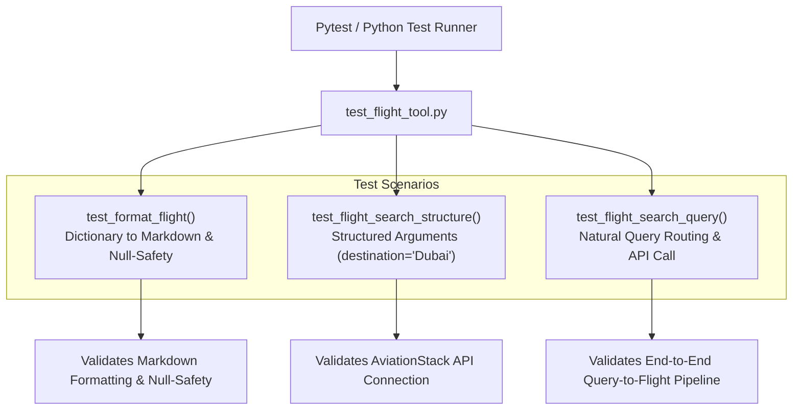

# Flight Tool Testing Guide (`test_flight_tool.py`)

This document details the test specifications for [`Multi_Agent_TourAI.tools.flight_tool`](file:///d:/DEPARTMENT%20OF%20COMPUTER%20SCIENCE/Computer%20Science/AI%20ML/AI_ML_DL/Gen%20AI%20Projects/Agent%20Systems/Multi-Agent-TourAI/Multi_Agent_TourAI/tools/flight_tool.py).

---

## Architecture & Test Flow



---

## Key Benefits & Advantages

### 1. Zero-Crash Guarantee (Null-Safety)
* **Missing API Fields Resilience:** AviationStack payloads often omit certain keys (e.g. no gate assigned, no delay data). The test suite verifies that `format_flight` never raises `KeyError` or `AttributeError`.

### 2. Live API Contract & Schema Verification
* **Endpoint Validation:** Ensures that request parameters (`dep_iata`, `arr_iata`, `access_key`) authenticate and communicate with the AviationStack REST API without HTTP errors.

### 3. End-to-End Workflow Verification
* **Integrated Routing:** Validates the complete path from natural language prompt ➔ IATA resolution ➔ API dispatch ➔ Markdown output formatting.

---

## Core Concepts & Testing Principles

### 1. Dual-Mode Search Validation
Tests both search modes supported by `flight_search()`:
* **Structured Mode:** Explicit arguments (`destination="Dubai", limit=2`).
* **Natural Language Mode:** Free-form sentence (`query="Plan a 7 days Japan trip from SriLanka"`).

### 2. Formatted Markdown Output Structure
Verifies that generated strings match the standardized format expected by AI Agent prompts (`Airline:`, `Flight:`, `Departure:`, `Arrival:`).

---

## Test Cases Breakdown

### 1. `test_format_flight()`
* **Objective:** Verifies that a sample flight dictionary correctly parses all airline, flight number, airport, terminal, gate, and delay attributes into Markdown.
* **Assertions:**
  * Checks for `Airline: SriLankan Airlines`
  * Checks for `Flight: UL302`
  * Checks for `Status: Scheduled`
  * Checks for `Airport: Bandaranaike International`
  * Checks for `IATA: CMB`
  * Checks for formatted delay: `Delay: 15 minutes`
  * Checks for fallback delay: `Delay: N/A`

### 2. `test_flight_search_structure()`
* **Objective:** Verifies API execution with a structured destination parameter.
* **Test Input:** `destination="Dubai", limit=2`
* **Assertions:** Returns a non-empty formatted flight string.

### 3. `test_flight_search_query()`
* **Objective:** Verifies end-to-end NLP query parsing and flight search execution.
* **Test Input:** `query="Plan a 7 days Japan trip from SriLanka", limit=2`
* **Assertions:** Returns a valid string response containing route status or available flight options.

---

## How to Run
```powershell
python tests/test_flight_tool.py
```
