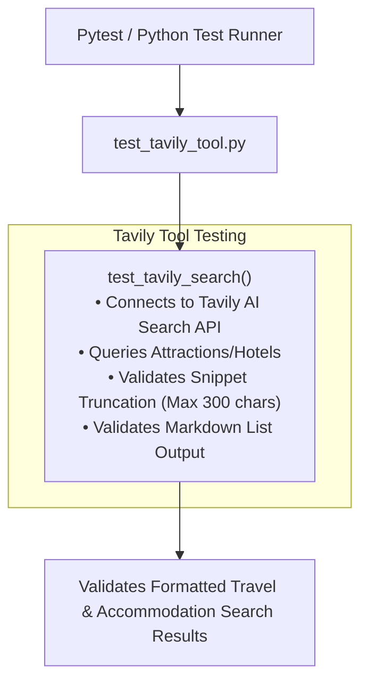

# Tavily Tool Testing Guide (`test_tavily_tool.py`)

This document details the test specifications for [`Multi_Agent_TourAI.tools.tavily_tool`](file:///d:/DEPARTMENT%20OF%20COMPUTER%20SCIENCE/Computer%20Science/AI%20ML/AI_ML_DL/Gen%20AI%20Projects/Agent%20Systems/Multi-Agent-TourAI/Multi_Agent_TourAI/tools/tavily_tool.py).

---

## Architecture & Test Flow



---

## Key Benefits & Advantages

### 1. Real-World Web Search Validation
* **Live Knowledge Retrieval:** Validates that `tavily_search` retrieves real-time, up-to-date hotel, attraction, and travel data from the live web for the agent.

### 2. LLM Context Window & Token Optimization
* **Token Bloat Protection:** Verifies that snippet text is capped at 300 characters, preventing raw HTML / bulky web pages from consuming excessive LLM context tokens.

### 3. Graceful Missing-Key Degradation
* **Safe Setup Guidance:** Ensures that when `TAVILY_API_KEY` is not present in `.env`, the tool returns a helpful configuration guide instead of raising an unhandled exception.

---

## Core Concepts & Testing Principles

### 1. Word-Boundary Truncation
Verifies that text exceeding 300 characters is cut off cleanly at the last full word using `rsplit(" ", 1)[0] + "..."` rather than splitting a word in the middle.

### 2. Structured Markdown Output
Validates that search items are formatted as numbered Markdown entries with bold titles and URLs (`1. **Title**\n URL\n Snippet`) ready for direct inclusion in AI agent memory.

---

## Test Cases Breakdown

### 1. `test_tavily_search()`
* **Objective:** Verifies that a travel query executes successfully and produces a structured list of recommendations.
* **Test Input:** `"Top attractions and hotels in Colombo Sri Lanka"`
* **Assertions:**
  * Returns a valid non-empty string.
  * Contains structured recommendations with titles, links, and summaries.

---

## How to Run

```powershell
pytest tests/test_tavily_tool.py -v
```
or
```powershell
python tests/test_tavily_tool.py
```
