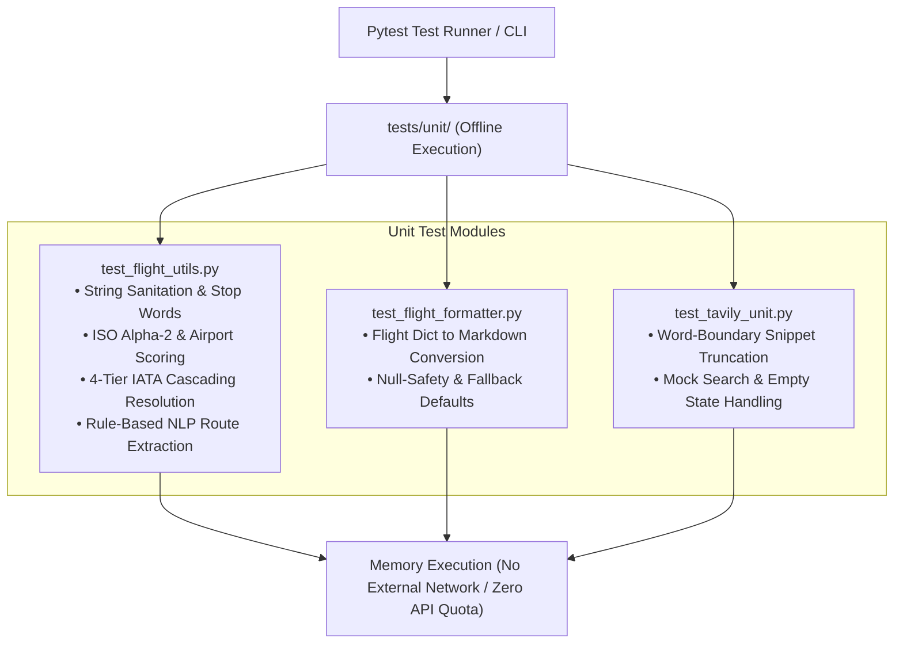

# Unit Testing Architecture & Technical Guide

The `tests/unit/` suite provides isolated, deterministic, and offline verification for all core logic, algorithms, regex patterns, and string parsing modules across the Multi-Agent TourAI project.

---

## Architecture & Execution Flow



---

## Key Benefits & Advantages

### 1. Instant Execution Speed & Fast Feedback
* **Sub-Second Execution:** All unit tests execute entirely in-memory in less than **500 milliseconds**.
* **Rapid Developer Iteration:** Developers can run the test suite repeatedly after every single code edit without waiting for slow HTTP handshakes.

### 2. Zero API Cost & Quota Protection
* **No External Network Calls:** Functions are tested with static in-memory fixtures and Python `unittest.mock` objects.
* **Cost Efficiency:** Consumes **zero credits** from third-party APIs (AviationStack, Tavily), preserving monthly allowances for production.

### 3. High Determinism & Flake-Free Reliability
* **No Network Flakiness:** Tests do not fail due to internet downtime, rate limits, or external server outages.
* **Reproducible Assertions:** Given the same test inputs, tests always produce identical results.

### 4. Comprehensive Edge Case & Boundary Verification
* **Resilience Testing:** Validates unpredictable user behavior such as empty inputs, `None` values, malformed country names, and noisy natural queries.

---

## Core Concepts & Testing Principles

### 1. Complete Test Isolation
* **Principle:** Each unit test focuses on a single function in isolation. 
* **Implementation:** External dependencies or shared states are decoupled using mocks so that failure in one module cannot cascade into another.

### 2. Mocking External Services (`unittest.mock`)
* **Principle:** Simulates API responses without touching the network.
* **Usage in `test_tavily_unit.py`:** A `MagicMock` substitutes `TavilyClient`, allowing verification of snippet truncation and missing-key behavior offline.

### 3. Deterministic NLP Pattern Testing
* **Principle:** Tests the full spectrum of user query structures against explicit expected outputs (`dep_iata`, `arr_iata`).
* **Covered Formats:** Single destination, "from X to Y", "to Y from X", direct IATA arrows ("CMB -> DXB"), and global search keywords.

---

## Test Modules Overview

| Test File | Target Module | Key Test Functions | What is Validated |
| :--- | :--- | :--- | :--- |
| `test_flight_utils.py` | `Multi_Agent_TourAI.utils.flight_utils` | • `test_clean_text()`<br>• `test_country_to_code()`<br>• `test_get_best_airport_for_country()`<br>• `test_resolve_location_to_iata()`<br>• `test_find_location_mentions()`<br>• `test_parse_route_patterns()` | Text cleaning, stop words removal, ISO code lookups, heuristic airport scoring, 4-tier IATA cascading resolution, and NLP routing. |
| `test_flight_formatter.py` | `Multi_Agent_TourAI.tools.flight_tool` | • `test_format_flight_complete()`<br>• `test_format_flight_partial_data()` | Markdown string conversion, attribute parsing (terminal, gate, delay), and null-safety when dictionary fields are missing. |
| `test_tavily_unit.py` | `Multi_Agent_TourAI.tools.tavily_tool` | • `test_tavily_search_snippet_truncation()`<br>• `test_tavily_search_missing_client()`<br>• `test_tavily_search_empty_results()` | Word-boundary snippet truncation (300 chars limit), graceful degradation when API keys are absent, and empty search results. |

---

## How to Run Unit Tests

### Run All Unit Tests with Pytest
```powershell
pytest tests/unit/
```

### Run with Verbose Output (Lists each test case)
```powershell
pytest tests/unit/ -v
```

### Run Individual Test Files Directly with Python
```powershell
python tests/unit/test_flight_utils.py
python tests/unit/test_flight_formatter.py
python tests/unit/test_tavily_unit.py
```
