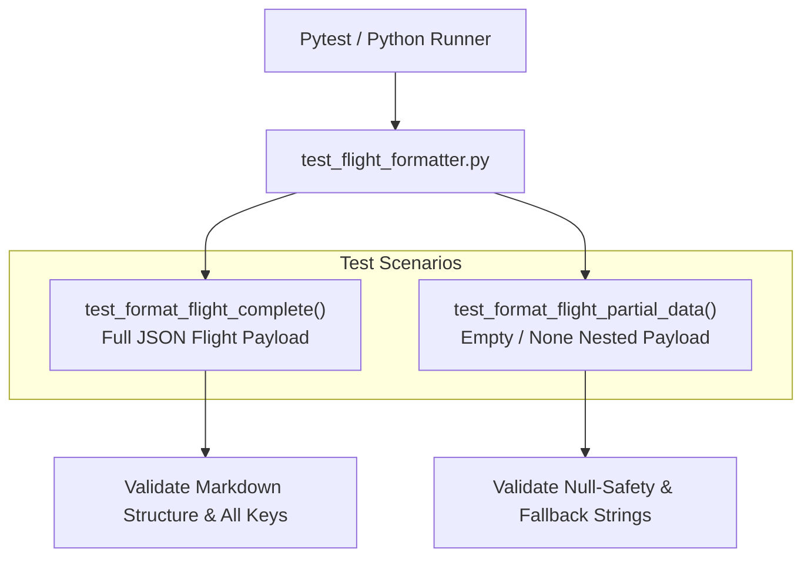

# Unit Test Guide: `test_flight_formatter.py`

This document details the unit test specifications for [`format_flight`](file:///d:/DEPARTMENT%20OF%20COMPUTER%20SCIENCE/Computer%20Science/AI%20ML/AI_ML_DL/Gen%20AI%20Projects/Agent%20Systems/Multi-Agent-TourAI/Multi_Agent_TourAI/tools/flight_tool.py#L26-L72) in `flight_tool.py`.

---

## Architecture & Test Flow



---

## Key Benefits & Advantages

### 1. Zero-Crash Guarantee (Null Safety)
* **API Payload Resilience:** Third-party REST APIs frequently omit keys or return `None` values (e.g. no gate assigned, no delay data). This test guarantees the formatter never raises `KeyError` or `AttributeError`.

### 2. Standardized Agent Input
* **Consistent Prompting:** Ensures flight information is always structured with exact markdown headings (`Airline:`, `Flight:`, `Departure:`, `Arrival:`) for uniform LLM processing.

### 3. Fast In-Memory Execution
* **Instant Verification:** Tests parse Python dictionaries purely in memory, finishing in under **10 milliseconds**.

---

## Core Concepts & Testing Principles

### 1. Complete Data Mapping
Tests that all expected fields (airline name, flight number, airport name, IATA code, terminal, gate, scheduled time, delay text) are extracted and displayed correctly.

### 2. Graceful Degradation & Fallback Defaults
Tests that missing keys fall back to predictable default strings (`"Unknown airline"`, `"Unknown flight number"`, `"N/A"`).

---

## Test Cases Breakdown

### 1. `test_format_flight_complete()`
* **Objective:** Verifies accurate parsing of a fully populated flight dictionary.
* **Sample Payload:**
  ```python
  {
      "flight_status": "scheduled",
      "airline": {"name": "SriLankan Airlines"},
      "flight": {"iata": "UL302"},
      "departure": {
          "airport": "Bandaranaike International",
          "iata": "CMB",
          "terminal": "1",
          "gate": "A4",
          "scheduled": "2026-09-20T08:00:00+00:00",
          "delay": 15,
      },
      "arrival": {
          "airport": "Singapore Changi",
          "iata": "SIN",
          "terminal": "3",
          "gate": "B2",
          "scheduled": "2026-09-20T14:30:00+00:00",
          "delay": None,
      },
  }
  ```
* **Assertions:**
  * Checks `Airline: SriLankan Airlines`
  * Checks `Flight: UL302`
  * Checks `Status: Scheduled`
  * Checks `Airport: Bandaranaike International`
  * Checks `IATA: CMB`
  * Checks delay formatting: `Delay: 15 minutes`
  * Checks fallback delay: `Delay: N/A`

### 2. `test_format_flight_partial_data()`
* **Objective:** Tests null-safety when the dictionary contains `None` for all nested objects.
* **Assertions:**
  * Ensures no unhandled exceptions are raised.
  * Validates fallback defaults: `"Unknown airline"`, `"Unknown flight number"`, `"Unknown departure airport"`.

---

## How to Run

```powershell
pytest tests/unit/test_flight_formatter.py -v
```
or
```powershell
python tests/unit/test_flight_formatter.py
```
