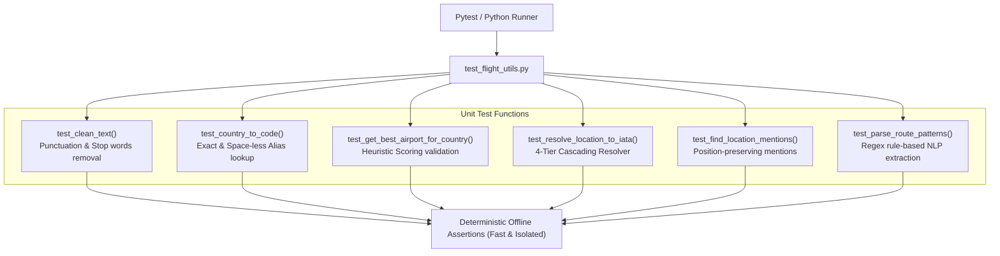

# Unit Test Guide: `test_flight_utils.py`

This document details the unit test specifications for [`Multi_Agent_TourAI.utils.flight_utils`](file:///d:/DEPARTMENT%20OF%20COMPUTER%20SCIENCE/Computer%20Science/AI%20ML/AI_ML_DL/Gen%20AI%20Projects/Agent%20Systems/Multi-Agent-TourAI/Multi_Agent_TourAI/utils/flight_utils.py).

---

## Architecture & Test Flow



---

## Key Benefits & Advantages

### 1. Zero External API Cost
* **Pure Offline Testing:** All lookups use offline libraries (`airportsdata`, `pycountry`) and static test data without making API calls.

### 2. High Execution Speed
* **Sub-Second Performance:** Completes all 6 test functions and dozens of assertions in less than **100 milliseconds**.

### 3. Comprehensive Edge-Case Coverage
* **Robust Verification:** Tests corner cases including `None` values, empty strings, punctuation strings, space-less country names (e.g. `srilanka`), and arbitrary sentence variations.

### 4. Regression Prevention
* **Safe Refactoring:** Ensures future modifications to `clean_text` regex or `parse_route` patterns do not break existing agent route resolution.

---

## Core Concepts & Testing Principles

### 1. Cascading Resolution Verification
Validates that if Tier 1 (direct IATA code) fails, the resolver gracefully falls through Tier 2 (city alias), Tier 3 (country code), and Tier 4 (fuzzy airport database match).

### 2. Rule-Based NLP Pattern Coverage
Tests every pattern branch implemented in `parse_route()`:
* **Global queries** (`"all country flight info"` ➔ `(None, None)`)
* **Direct IATA arrows** (`"CMB to DXB"` ➔ `("CMB", "DXB")`)
* **From-To routes** (`"flights from Sri Lanka to Japan"` ➔ `("CMB", "HND")`)
* **To-From routes** (`"Plan a trip to Dubai from Colombo"` ➔ `("CMB", "DXB")`)
* **Single destination fallback** (`"Plan a 7 days Japan trip"` ➔ `("CMB", "HND")`)

---

## Test Cases Breakdown

### 1. `test_clean_text()`
* **Objective:** Verifies lowercase conversion, punctuation stripping, and stop words removal.
* **Test Cases:**
  * `"Flights to Dubai, under $500!"` ➔ `"dubai 500"`
  * `"Trip from Sri Lanka to Japan!!!"` ➔ `"sri lanka japan"`
  * `""` (Empty string) ➔ `""`
  * `None` ➔ `""`

### 2. `test_country_to_code()`
* **Objective:** Validates ISO 3166-1 alpha-2 resolution and memoization caching.
* **Test Cases:**
  * `"Sri Lanka"` ➔ `"LK"`
  * `"srilanka"` (Space-less alias) ➔ `"LK"`
  * `"Japan"` (PyCountry exact match) ➔ `"JP"`
  * `"United Arab Emirates"` ➔ `"AE"`
  * `"InvalidCountry999"` (Non-existing country) ➔ `None`

### 3. `test_get_best_airport_for_country()`
* **Objective:** Tests heuristic scoring algorithm when picking the primary international airport for a country.
* **Test Cases:**
  * `"LK"` ➔ `"CMB"` (Bandaranaike International)
  * `"JP"` ➔ `"HND"` (Tokyo Haneda International)
  * `"AE"` ➔ `"DXB"` (Dubai International)

### 4. `test_resolve_location_to_iata()`
* **Objective:** Verifies the 4-tier cascading resolution strategy.
* **Test Cases:**
  * `"CMB"` (Direct uppercase) ➔ `"CMB"`
  * `"dxb"` (Direct lowercase) ➔ `"DXB"`
  * `"Tokyo"` (City match) ➔ `"HND"`
  * `"Colombo"` (City match) ➔ `"CMB"`
  * `"Japan"` (Country name) ➔ `"HND"`
  * `"Sri Lanka"` (Country name) ➔ `"CMB"`
  * `"FakeCityX"` (Invalid input) ➔ `None`

### 5. `test_find_location_mentions()`
* **Objective:** Ensures location mentions in free-form text are extracted and sorted in their exact order of appearance.
* **Test Input:** `"Plan a holiday from Sri Lanka to Japan including Tokyo"`
* **Assertions:**
  * Detects `"sri lanka"` (Index 0)
  * Detects `"japan"` (Index 1)

### 6. `test_parse_route_patterns()`
* **Objective:** Tests rule-based NLP route extraction for various sentence structures.
* **Test Cases:**
  * Global search: `"all country flight info"` ➔ `(None, None)`
  * Direct arrow: `"CMB to DXB"` ➔ `("CMB", "DXB")`
  * Direct arrow: `"CMB -> DXB"` ➔ `("CMB", "DXB")`
  * "from X to Y": `"flights from Sri Lanka to Japan for 7 days"` ➔ `("CMB", "HND")`
  * "to Y from X": `"Plan a trip to Dubai from Colombo"` ➔ `("CMB", "DXB")`
  * "X to Y": `"Colombo to London"` ➔ `("CMB", "LHR")`
  * Single destination fallback: `"Plan a 7 days Japan trip"` ➔ `("CMB", "HND")`

---

## How to Run

```powershell
pytest tests/unit/test_flight_utils.py -v
```
or
```powershell
python tests/unit/test_flight_utils.py
```
