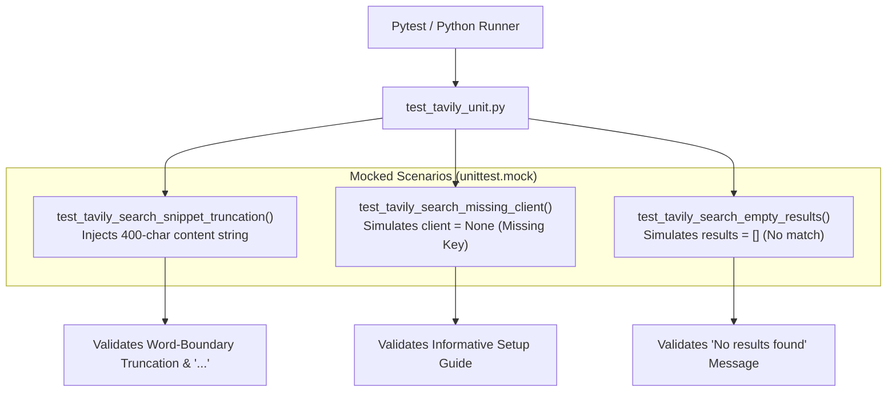

# Unit Test Guide: `test_tavily_unit.py`

This document details the isolated unit test specifications for [`Multi_Agent_TourAI.tools.tavily_tool`](file:///d:/DEPARTMENT%20OF%20COMPUTER%20SCIENCE/Computer%20Science/AI%20ML/AI_ML_DL/Gen%20AI%20Projects/Agent%20Systems/Multi-Agent-TourAI/Multi_Agent_TourAI/tools/tavily_tool.py).

---

## Architecture & Test Flow



---

## Key Benefits & Advantages

### 1. Zero Search API Cost
* **Mocked Client:** Uses `unittest.mock.MagicMock` to simulate Tavily search responses, testing string transformation logic without calling external endpoints or burning paid monthly search credits.

### 2. LLM Context Window & Token Protection
* **Snippet Length Verification:** Ensures long web search results are always trimmed to a maximum of 300 characters, preventing prompt bloating in AI Agents.

### 3. Graceful Missing-Key Handling
* **Safe Degradation:** Guarantees that when a new user runs the project without `TAVILY_API_KEY` configured in `.env`, the tool returns a helpful setup message instead of crashing.

---

## Core Concepts & Testing Principles

### 1. Word-Boundary Truncation
Verifies that `snippet[:300].rsplit(" ", 1)[0] + "..."` splits words cleanly at spaces rather than slicing words in half.

### 2. Dependency Injection / Client Patching
Temporarily overrides `tavily_tool.client` during tests and restores it in a `finally:` block, ensuring clean test isolation.

---

## Test Cases Breakdown

### 1. `test_tavily_search_snippet_truncation()`
* **Objective:** Verifies that search snippets exceeding 300 characters are truncated at the nearest whole word with an ellipsis.
* **Assertions:**
  * Contains Title and URL in Markdown.
  * String ends with `...`.

### 2. `test_tavily_search_missing_client()`
* **Objective:** Verifies behavior when `client is None`.
* **Assertion:** Contains `"Tavily search unavailable: TAVILY_API_KEY is not configured."`.

### 3. `test_tavily_search_empty_results()`
* **Objective:** Verifies response when no web results match the query.
* **Assertion:** Contains `"No results found for query"`.

---

## How to Run

```powershell
pytest tests/unit/test_tavily_unit.py -v
```
or
```powershell
python tests/unit/test_tavily_unit.py
```
